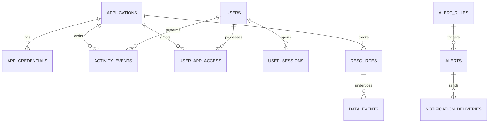

# Architecture du Superviseur d'Écosystème

## 1. Principes Fondamentaux de Conception

1. **Découplage Total et Zéro Dépendance Forte** :
   Le superviseur est une application autonome. Une défaillance ou indisponibilité du superviseur n'interrompt jamais les fonctionnalités des applications clientes de l'écosystème.

2. **Ingestion Asynchrone & Non-Bloquante** :
   Les SDKs applicatifs mettent les événements en mémoire tampon et les transmettent en arrière-plan sans bloquer les requêtes utilisateur. Côté serveur, l'ingestion utilise Redis Streams avec basculement automatique direct en base de données.

3. **Identification Pérenne par Couple (Issuer, Sub)** :
   Conformément aux normes OIDC, les utilisateurs sont identifiés de manière immuable par leur `issuer` (`https://sso-a.oussamma.tn`) et leur `sub`. Les changements d'adresse email ou de nom d'affichage n'altèrent pas l'historique de l'utilisateur.

4. **Minimisation des Données & Confidentialité** :
   Le superviseur ne stocke jamais :
   - Mots de passe ou hachages de mots de passe
   - Tokens de session ou secrets JWT
   - Contenu textuel des messages privés
   - Corps complets des documents ou fichiers
   - Prompts et réponses privées des utilisateurs adressés à l'IA

5. **Traçabilité & Immuabilité de l'Audit** :
   Les événements reçus sont horodatés au format UTC, corrélés (`correlation_id`) et conservés selon les politiques de rétention configurées.

---

## 2. Composants Système

| Composant | Technologie | Rôle |
| :--- | :--- | :--- |
| **Frontend** | Next.js 14, Tailwind CSS, TypeScript, Lucide | Interface utilisateur réactive, tableaux de bord, User Activity 360°, requêtes en langage naturel |
| **Backend API** | FastAPI, Python 3.11, Pydantic V2 | Endpoints d'ingestion sécurisés, validation d'événements, exposition des analytics et passerelle SSO |
| **Workers** | Python AsyncIO, Redis Consumer Group | Dépilement des flux Redis Streams, calcul des agrégats métriques, déclenchement du moteur d'alertes |
| **Base Principale** | PostgreSQL 16 | Stockage relationnel structuré des événements, identités, ressources et alertes |
| **File de Messages** | Redis 7 Streams | Ingestion à haut débit et amortissement des pics de charge |
| **Passerelle IA** | LiteLLM (`ai.oussamma.tn`) | Fournisseur central d'intelligence artificielle et exécution des prompts de supervision |

---

## 3. Schéma Relationnel de la Base de Données

